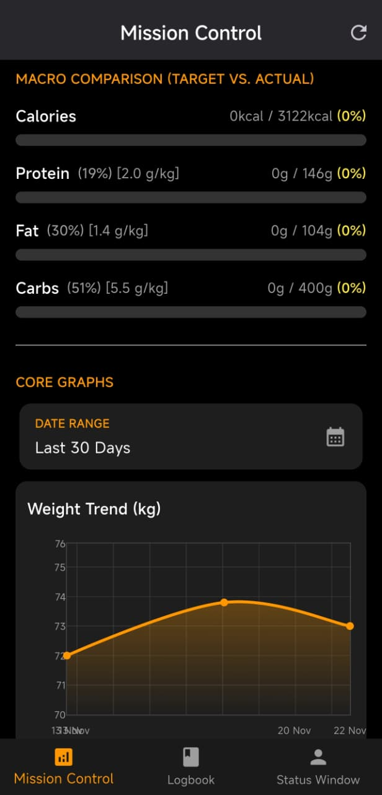
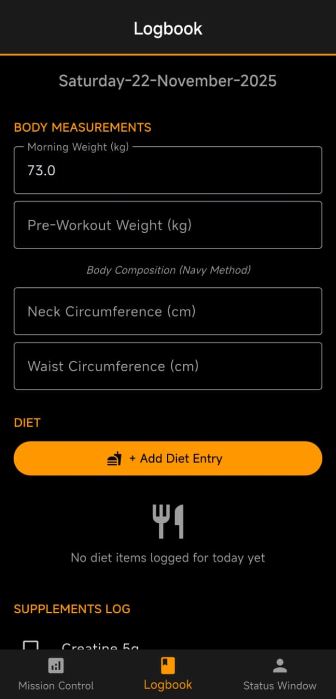
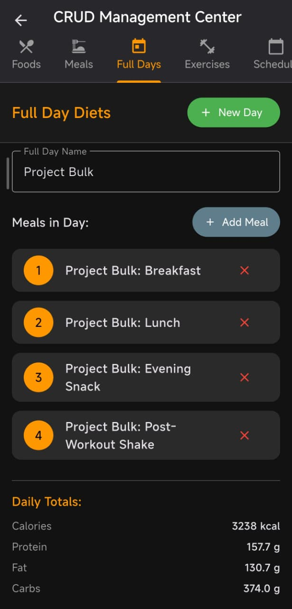
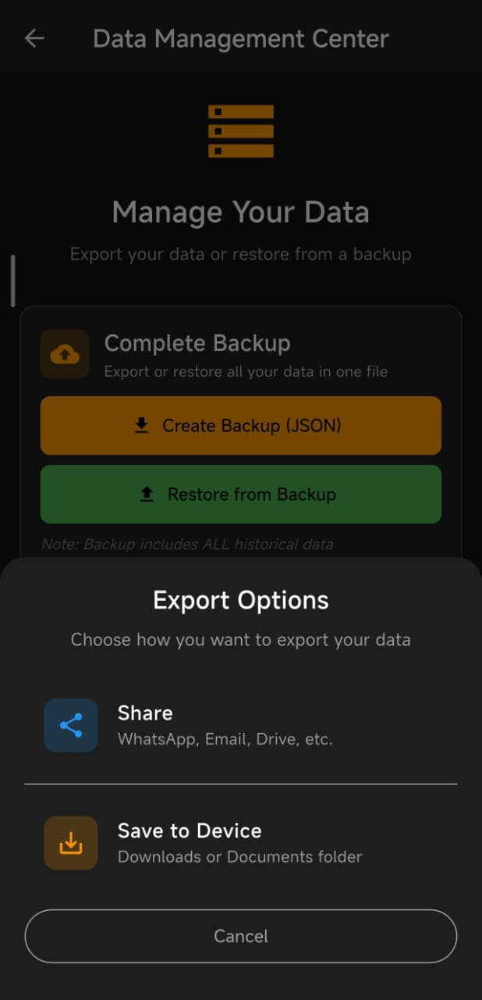

# Forge

A fully offline fitness and nutrition logbook for Android, built in Flutter. No account, no cloud, no subscription. Made for the self-directed athlete who already has a plan and wants a fast, private, powerful tool to track it.

> **Note:** This repository is a **showcase**. The full source is private. Forge is an active project being prepared for store release. The screenshots, architecture and formulas below reflect the real app.

---

## What It Does

Tracks workouts, nutrition, body composition, sleep, hydration, jogging and supplements, entirely on-device. The standout is a **hierarchical food system**: create individual foods, combine them into meals, combine meals into full-day plans. Meal-prep the same Monday every week? Load your "Monday Plan" and the whole day logs at once.

It calculates **TDEE** (Mifflin-St Jeor, with selectable Harris-Benedict and Katch-McArdle formulas), tracks **body-fat %** with the **US Navy method**, derives macro targets from a preset (Balanced, High-Protein, Keto or Custom), and plots everything as trend graphs.


*Mission Control: today's macro progress and historical trends*


*Daily logging interface*

---

## Highlights

- **100% offline and private**: all data lives in a local SQLite database. No accounts, no servers, no tracking.
- **Adaptive TDEE**: estimates your real maintenance calories from what you logged eating and your weight trend (least-squares fit), instead of trusting a formula. Waits for enough data before it shows anything, and you choose whether to adopt it.
- **Smart insights**: plateau detection, protein adherence, personal records and a 4-week projection. Pure on-device rules, no AI service, shown only once there is enough data.
- **Smart targets**: water, fiber, healthy-weight range, heart-rate zones and estimated 1RM. Each one is labelled **Recommended** (calculated from your data) or **Guideline** (general advice), with the reasoning one tap away.
- **Rest tracking**: rest between sets is recorded from an optional timer or derived from the time between logged sets. Implausible gaps are flagged and kept out of the averages, and you can correct them.
- **Background rest alert**: the optional rest timer can schedule a local notification, so the alert arrives with the screen off. It is a device-scheduled alarm, not a push: nothing leaves the phone.
- **Onboarding and empty states**: a short first-run walkthrough, plus helpful empty screens instead of blank ones.
- **Data safety**: complete JSON backup and restore, per-table CSV export, a last-backup badge (green, yellow, red) in the Status Window, and a guarded "delete all data" reset.
- **Verified math**: every formula (BMR/TDEE, Navy body fat, macro split, pace, sleep, unit conversion) is covered by automated unit tests asserting against independently hand-computed values. Schema migrations are tested against the real older schemas.
- **Workout tracking**: schedule-driven exercise auto-population, switchable weekly plans, an exercise library with how-to text, set logging, and a built-in stopwatch for timed holds.
- **Units**: metric or imperial, as a display and input layer. Storage and math stay metric.


*Managing foods, meals, exercises and schedule*


*Backup, restore and export*

---

## Architecture

- **Flutter / Dart**, dark theme, 3-tab navigation (Mission Control, Logbook, Status Window).
- **Drift** (type-safe SQLite) with a relational schema: master and config tables, daily logs, and junction tables for many-to-many relationships (meal compositions, full-day links, weekly schedule).
- **Single-responsibility structure**: schema, seeding and queries are separated. All business math lives in pure, unit-tested classes (calculator, adaptive TDEE, insights, smart targets, rest), with no calculation logic in the UI.
- **Provider** for state, **fl_chart** for visualisation, **path_provider** for local storage.
- **Forward-only, tested migrations**: every schema version has a checked-in dump and a test that runs the real old schema and asserts the data survives.

---

## The Formulas

**TDEE (Mifflin-St Jeor):**
```
Male:   BMR = (10 × weight_kg) + (6.25 × height_cm) − (5 × age) + 5
Female: BMR = (10 × weight_kg) + (6.25 × height_cm) − (5 × age) − 161
TDEE = BMR × Activity Factor (1.2 to 1.9, or a custom multiplier)
```
Also selectable: **Harris-Benedict** (revised) and **Katch-McArdle** (uses lean body mass from the Navy measurement).

**Body Fat % (US Navy, metric):**
```
Male:   BF% = 495 / (1.0324 − 0.19077·log10(waist − neck) + 0.15456·log10(height)) − 450
Female: BF% = 495 / (1.29579 − 0.35004·log10(waist + hip − neck) + 0.22100·log10(height)) − 450
```

**Macro targets:** protein from body weight, fat as a share of calories, carbohydrates as the remainder, clamped so an over-aggressive deficit can never produce negative carbs.

**Adaptive maintenance:** `TDEE = average intake − (weight change × 7700 kcal/kg) ÷ days`, with the weight change taken from a least-squares trend rather than first-versus-last.

---

## Tech Stack

Flutter · Dart · Drift (SQLite) · Provider · fl_chart · path_provider · flutter_local_notifications. **No backend, no cloud services.**

---

## What This Project Demonstrates

- Designing a relational schema with proper foreign keys and junction tables.
- Implementing scientific formulas correctly and **locking them with automated tests**.
- Offline-first architecture with local persistence, tested migrations and full backup and restore.
- Reactive, real-time Flutter UIs and clean separation of concerns.
- Shipping a complete app end-to-end, solo.

---

## Contact

**Shobhit Bansal**
LinkedIn: [linkedin.com/in/shobhitbansal2002](https://linkedin.com/in/shobhitbansal2002)
Portfolio: [shobhitbansal2002.vercel.app](https://shobhitbansal2002.vercel.app)

---

Built with Flutter. Works completely offline. Designed for real-world daily use.
